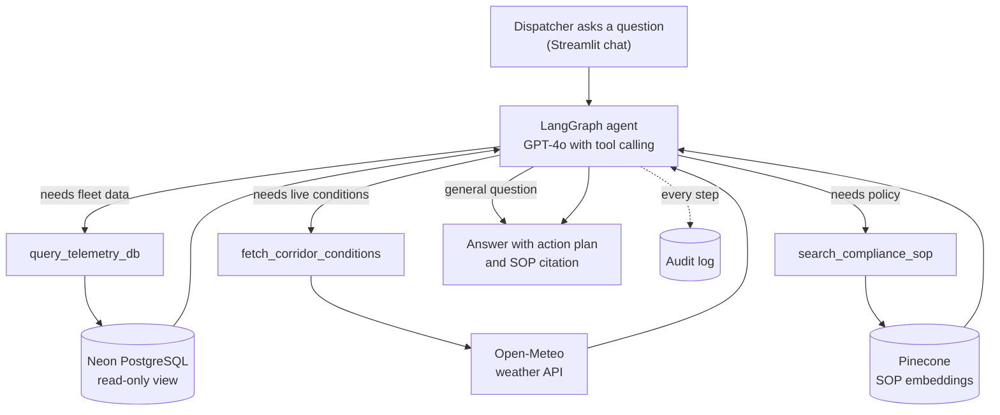
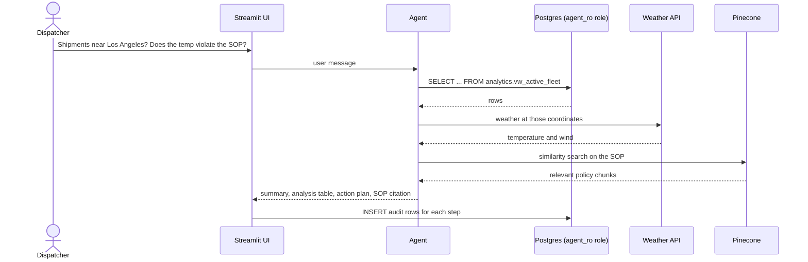
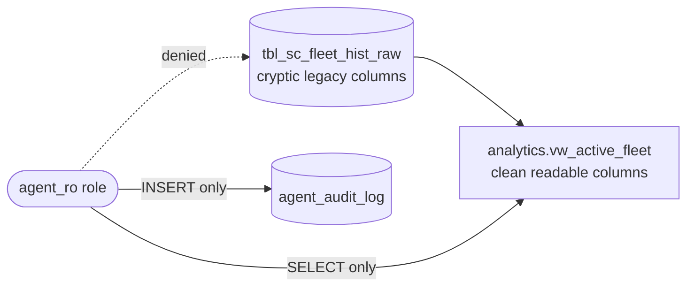
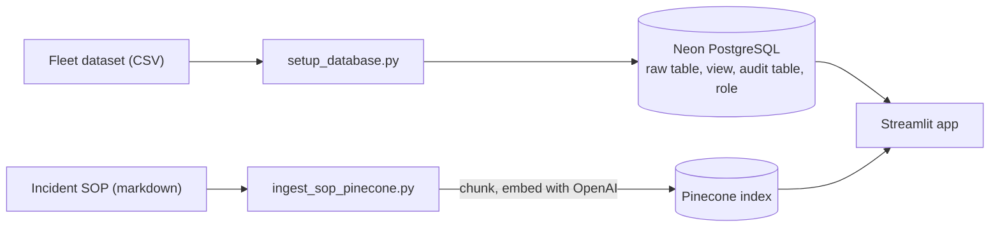

# CargoChain 🧊🚚


🌐 **[Live demo](https://cargochain-9cdqpyffywbljmea3wpn6k.streamlit.app/)**

**An AI dispatcher that can't break your database.**

CargoChain is a tool-calling agent for refrigerated logistics. A dispatcher asks a question in plain English; the agent decides whether it needs fleet data, live weather, the company SOP, or nothing at all, then replies with an analysis and an action plan.

The interesting part is not that an LLM can write SQL. It's that it does so **inside a cage**: the agent never sees the raw legacy table, runs as a role that can only read one view, and leaves an audit trail of every step it takes.

> *"Find any active shipments near Los Angeles, check the local weather there, and tell me if the current cargo temperature violates the SOP for fresh perishables."*

---

## How a question flows through the system



## One request, step by step



## The cage: how the database is protected



Four independent layers, so a failure in one does not expose the data:

1. **A semantic view.** The agent only knows readable column names, never the raw legacy schema.
2. **Least-privilege role.** `agent_ro` can `SELECT` the view and `INSERT` into the audit log. Reading the raw table, updating the view, dropping objects and reading the audit log are all denied by the database.
3. **Query guards in the tool.** The model's SQL is parsed with `sqlglot`, not string-matched. Only a single `SELECT` on the one approved view is accepted (no DML or DDL, other tables, `INTO`, or `pg_*` functions), rows are capped at 100, and an `EXPLAIN` cost ceiling rejects runaway queries before they execute. Every query also runs in a read-only transaction with a 10 s statement timeout. These checks give the model clear errors; the database role remains the real security boundary.
4. **Audit trail.** Each reasoning step and tool call is stored and viewable in an admin-protected page. A failed audit write is retried, logged, and shown to the operator in the UI instead of being swallowed.

## Setup pipeline



---

## Design decisions

| Decision | Why |
|---|---|
| Agent reads a **view**, not tables | Gives the model stable, readable names and keeps the raw schema out of its reach. |
| Separate **owner** and **agent** database roles | The setup script needs full rights; the running agent should not have them. |
| Tools instead of a fixed pipeline | Questions need different sources. A general question uses none, a compliance check uses all three. |
| Policies in a **vector store**, numbers in **SQL** | Semantic search suits text rules; exact filters and counts suit SQL. |
| Neon for the database | A free hosted Postgres lets the whole app deploy without a server to manage. |
| One reused connection pool | Opening a fresh SSL connection per query made the remote database several times slower. |

## Tech stack

| Layer | Technology |
|---|---|
| UI | Streamlit |
| Agent | LangGraph, LangChain, OpenAI GPT-4o |
| Embeddings and vector store | OpenAI embeddings, Pinecone |
| Database | PostgreSQL on Neon, SQLAlchemy, psycopg |
| External data | Open-Meteo weather API |
| Tooling | uv, Python 3.12 |

## Data

About 32,000 hourly readings from a public dynamic supply-chain logistics dataset: GPS position, cargo temperature, condition, risk class, delay probability, port congestion and route risk. It is loaded into a deliberately cryptic table (`tbl_sc_fleet_hist_raw`) to imitate a client's legacy database, and exposed through a clean view.

## Project structure

```
data/raw/        fleet dataset (CSV)
data/policy/     incident SOP that is embedded into Pinecone
scripts/
  setup_database.py       loads the CSV, creates the view, audit table and read-only role
  ingest_sop_pinecone.py  chunks and embeds the SOP into Pinecone
src/
  db.py            database engines (owner and least-privilege agent)
  agent_tools.py   the three agent tools
  orchestrator.py  LangGraph agent
  ui.py            Streamlit app and audit-log viewer
  prompts/         system prompt
```

## Run it locally

1. Install [uv](https://docs.astral.sh/uv/) and clone the repository.
2. Create free accounts for [Neon](https://neon.com) and [Pinecone](https://www.pinecone.io), and get an OpenAI API key.
3. Create a `.env` file in the project root:
   ```
   DATABASE_URL=<Neon connection string>
   AGENT_DB_PASSWORD=<a new password for the read-only role>
   OPENAI_API_KEY=<key>
   PINECONE_API_KEY=<key>
   Embeddings_model=OPENAI
   Agent_llm=OPENAI
   SQL_ADMIN_USER=<admin username for the audit page>
   SQL_ADMIN_PASSWORD=<admin password for the audit page>
   ```
4. Install and prepare the data:
   ```
   uv sync
   uv run python scripts/setup_database.py
   uv run python scripts/ingest_sop_pinecone.py
   ```
5. Start the app:
   ```
   uv run streamlit run src/ui.py
   ```

## Deploy

Designed for Streamlit Community Cloud with Neon as the database. The slim `requirements.txt` lists only what the app needs. Put the `.env` values above into the app's Secrets settings.

## Limitations

- The sample data is historical and treated as "active" fleet data for demonstration.
- The free tiers used (Neon, Pinecone, Streamlit) sleep when idle, so the first request after a pause is slower.
- The audit viewer uses a single shared admin login and is meant for demos.
- The corridor risk indicator is a prototype heuristic (a single wind-speed threshold), not a validated logistics risk model.
- Conversation state is checkpointed to PostgreSQL; if that is unavailable the app falls back to in-memory state and logs a warning.
- There is no automated evaluation set yet, so answer quality is checked by hand.


 
